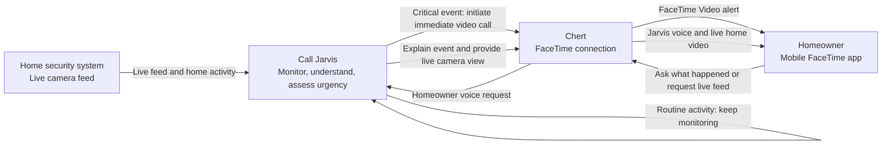

# Call Jarvis: the intelligent bridge between your home and you

Call Jarvis connects a home security camera system to its homeowner through Chert and FaceTime. It processes the camera feed, recognizes events that need attention, and immediately initiates a FaceTime Video call when an event is critical. During that conversation, the homeowner can ask to see the live feed and understand what is happening in the house.

This is the product architecture for the home-security use case.

## Architecture

## The homeowner's journey

1. **Monitor the home.** The home camera supplies a live feed. Call Jarvis processes the activity and assesses whether anything needs attention.
2. **Call when it matters.** If an event is critical, Call Jarvis immediately initiates a FaceTime Video call to the homeowner through Chert and explains why it is calling. Routine activity continues through monitoring.
3. **Ask to see what is happening.** The homeowner says, “Show me the live feed.” Chert carries that request back to Call Jarvis during the same call.
4. **See, ask, and respond.** Call Jarvis delivers the home camera view through the FaceTime connection. The homeowner can see the house, ask Jarvis questions, and decide how to respond while the conversation continues.

## Example: a possible intruder

A home camera captures suspicious activity near an entry. Call Jarvis assesses it as critical and calls the homeowner through Chert. Jarvis explains the alert. The homeowner asks to see the camera, receives the live view in FaceTime, and uses the conversation to decide what to do next. This is an illustrative product scenario, not a claim that a specific intruder classifier has been implemented.

## Who does what?

| Component | Role |
| --- | --- |
| Home security system | Supplies the live camera view and activity from the house. |
| Call Jarvis | Processes home activity, assesses urgency, initiates alerts, explains the event, and responds to requests for the live feed. |
| Chert | Connects Call Jarvis and the homeowner over FaceTime, carrying the call, speech, and video. |
| Homeowner | Receives the alert, asks to see the house, talks to Jarvis, and decides how to respond. |

**Core story:** Your home provides the feed. Call Jarvis decides when it needs your attention. Chert connects the call. You can see what is happening and speak to Jarvis from FaceTime.

[Editable SVG](./data-flow.svg) · [Detailed implementation mapping](./IMPLEMENTATION_FLOW.md)
