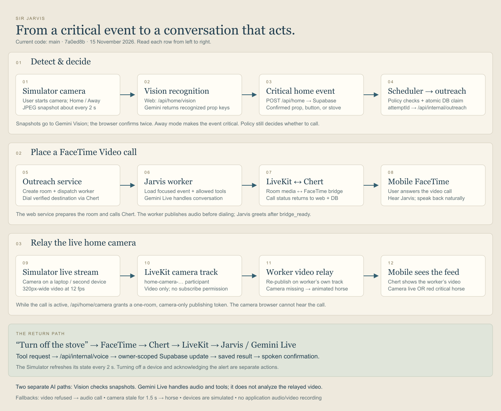
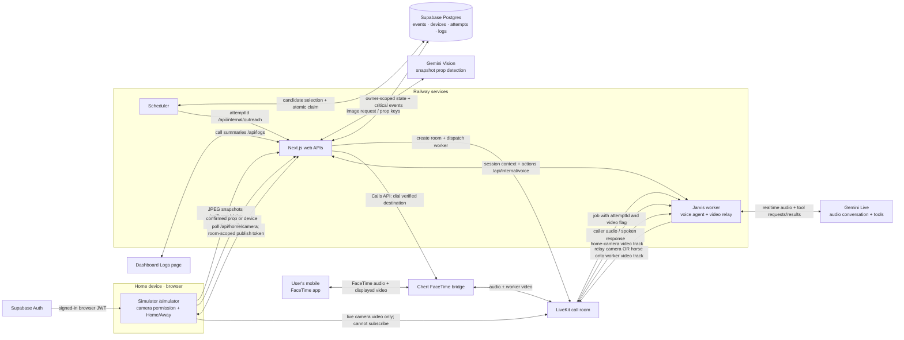
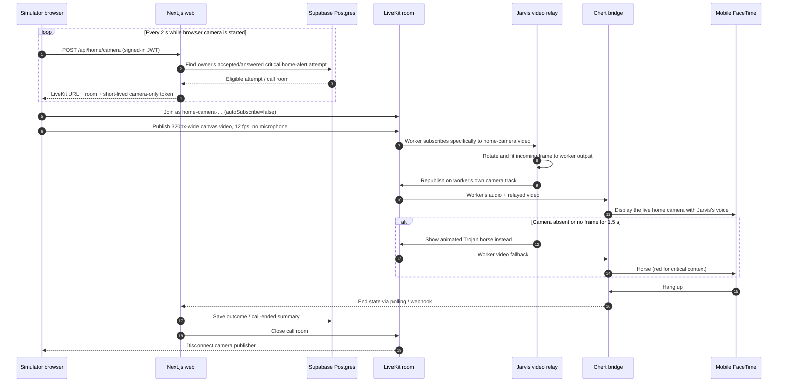

# Sir Jarvis: camera → critical alert → FaceTime → action

Architecture traced from `main` at `7a0ed8b` (15 November 2026). This describes the current implementation, not a proposed integration. Deployment/test claims from the README are kept separate from code behavior.



## System map



The repeated trip through the worker is intentional: FaceTime displays the video published by the **same participant that speaks**. Publishing the browser camera into LiveKit alone does not put it on the FaceTime screen.

## 1. Detect a critical event and place the call

```mermaid
sequenceDiagram
  autonumber
  participant S as Simulator browser
  participant W as Next.js web
  participant V as Gemini Vision
  participant D as Supabase Postgres
  participant Q as Scheduler
  participant L as LiveKit room
  participant J as Jarvis worker
  participant C as Chert
  participant P as Mobile FaceTime

  S->>S: User starts camera; home set to Away
  loop About every 2 s, with no overlapping recognition request
    S->>W: POST /api/home/vision (JWT + JPEG snapshot)
    W->>V: Prop recognition request (store: false)
    V-->>W: Recognized prop keys
    W-->>S: seen[]
    S->>S: Require 2 consecutive successful detections
  end
  S->>W: POST /api/home (action: trigger, prop)
  W->>D: Set simulated device; read Home/Away and cooldown
  alt Away; no matching unacknowledged event inside cooldown
    W->>D: Insert critical home_event, outreach_eligible=true
  else Home or cooldown
    W-->>S: Quiet event or cooldown response; no new critical call
  end
  Q->>D: list_escalation_candidates
  Q->>D: claim_escalation_attempt (atomic + idempotent)
  D-->>Q: attemptId (when eligible)
  Q->>W: POST /api/internal/outreach (OUTREACH_TOKEN, attemptId)
  W->>D: Re-check delivery authorization; resolve owner and destination
  W->>L: Create room; dispatch worker with attemptId + video=true
  L->>J: Start job and connect
  J->>W: session.start (VOICE_TOOL_TOKEN + call identifiers)
  W->>D: Resolve attempt owner; load focused event and home state
  W-->>J: Context + allowed tools
  J->>L: Publish audio and video before dialing
  W->>L: Wait for real worker participant with an unmuted audio track
  W->>C: Calls API: verified number, audio=true, video=true, room token
  C->>P: Ring FaceTime Video
  P-->>C: Answer
  C->>L: Bridge the phone into the call room
  W->>C: Poll call state/events (or handle webhook)
  W->>L: Set chert_bridge_ready metadata
  L-->>J: Bridge ready
  J->>P: Spoken alert via LiveKit → Chert
```

Direct Trigger buttons bypass snapshot detection. Turning the stove on while Away, or switching to Away while the stove is already on, also raises the stove event. These paths use the same critical-event and outreach pipeline.

Eligibility includes a verified destination, outreach consent, selected channels, quiet hours, the daily call cap, acknowledgment state, and existing attempts. A critical event is a request to evaluate outreach, not a guarantee that a call is placed. The live deployment interval is documented as 5 seconds; the scheduler code defaults to 20 seconds. Recognition latency and call setup add time, so this is not a fixed response-time guarantee.

## 2. Show the live camera on the mobile FaceTime screen



The browser token is scoped to one room, expires after 15 minutes, permits only camera publication, and cannot subscribe to audio/video or send data. The camera device cannot listen to the call through this token. The user must have started the Simulator camera; the server cannot remotely grant browser camera permission.

Alert video output is 320×180 at up to 12 fps. The fallback avatar updates at 8 fps on an outbound alert. On an inbound video call, the worker uses a 640×360 output with a 15 fps avatar and fits the smaller live camera into that output. Detection snapshots are a separate, 512px-wide JPEG path; the continuous video stream does not pass through the Vision API.

## 3. Speak back, perform an action, and update the Simulator

```mermaid
sequenceDiagram
  autonumber
  participant P as Mobile FaceTime
  participant C as Chert bridge
  participant L as LiveKit room
  participant J as Jarvis worker
  participant G as Gemini Live
  participant W as Next.js voice API
  participant D as Supabase Postgres
  participant S as Simulator browser

  P->>C: User audio: Turn off the stove
  C->>L: Caller audio track
  L->>J: Audio from this call's participant
  J->>G: Realtime audio and trusted session context
  G-->>J: Tool request: controlDevice
  J->>W: POST /api/internal/voice (action, args, call identifiers)
  W->>D: Resolve owner from attempt; update owned simulated device
  D-->>W: Saved device state
  W->>D: Best-effort action summary in communication_metadata
  W-->>J: Structured success / failure
  J->>G: Tool result
  G-->>J: Spoken confirmation based on saved result
  J->>L: Agent audio
  L->>C: Audio to FaceTime bridge
  C->>P: User hears the outcome
  S->>W: GET /api/home (2 s state refresh)
  W->>D: Read owner-scoped devices and events
  W-->>S: Updated stove tile and event feed
  Note over P,D: Acknowledge the alert is a separate action from switching the device
```

Jarvis handles `acknowledgeHomeEvent`, `setHomeMode`, reminder actions, and check-ins through the same authenticated tool boundary. The model never supplies the owner ID. Actions affect simulated devices in Postgres; there is no physical stove/IoT integration in this path. Logs store call reasons, actions, and outcomes, not recordings or transcripts.

## User-initiated call: “show me the camera”

For an inbound FaceTime Video call with `JARVIS_VIDEO=1`, the horse appears first. The caller asks to see the camera → Gemini Live requests `showCamera({show:true})` → the voice API writes a `camera_on` event with the room → the Simulator's next `/api/home/camera` poll obtains a token → the same video relay starts. “Hide the camera” writes `camera_off`; call end or a 15-minute stale request also stops discovery. On an outbound critical home-alert call, camera discovery is automatic and `showCamera` is omitted from the tool list.

Inbound routing in the documented trial setup still needs the owner's laptop running `chert dev`; the custom-webhook route also exists in the repository. Inbound tools use `VOICE_DEMO_USER_ID` because the bridge does not provide caller-number identity. This means an inbound camera request is associated with that demo account, not an independently authenticated mobile caller. Outbound critical-alert calls resolve their account from the stored notification attempt.

## Boundaries and fallback behavior

| Situation | Current behavior |
| --- | --- |
| Browser camera and receiving FaceTime on the same phone | Camera may pause when FaceTime rings. Use a laptop/second device for the Simulator camera. |
| Missing camera, stopped browser, or stale frames | Worker shows the horse. Its critical color applies to the fallback, not an overlay on the live camera. |
| Video call explicitly refused by the line | Outreach retries the call as audio with a distinct idempotency key. No live video is visible on that audio call. |
| `ALERT_VIDEO=0` on web | Critical alerts use audio; camera-session endpoint returns no live session. |
| `JARVIS_VIDEO=1` on worker | Enables the video track on inbound video calls. Outbound alert feed uses its dispatch flag separately. |
| Prop recognition unavailable | Trigger/device buttons still exercise the event and call path. |
| Model asks about live video | Gemini Live has `videoEnabled:false`. It knows event/device context; it cannot inspect or describe the relayed live frames. |
| Data retention | Application code does not record audio/video or transcripts. Snapshots use `store:false`; events, actions, and call outcomes are persisted. This is not a claim about third-party retention policies. |

The repository README reports critical-alert video working from a user test. Snapshot recognition after the model change and the inbound “show me the camera” path remain listed there as needing real-call verification. New-user phone signup is currently documented as blocked until an SMS provider is configured. These are handoff notes, not live-environment checks performed for this diagram.

## Source map

| Responsibility | Implementation |
| --- | --- |
| Snapshot loop, two-look confirmation, call polling, video publisher | [Simulator page](../../src/app/simulator/page.tsx) |
| JWT authentication | [signedInUser](../../src/lib/server/auth.ts) |
| Vision endpoint and recognition | [vision route](../../src/app/api/home/vision/route.ts), [vision service](../../src/lib/server/home/vision.ts) |
| Device/critical-event creation and cooldown | [home service](../../src/lib/server/home/service.ts) |
| Candidate policy, claims, delivery authorization | [scheduler handler](../../supabase/functions/escalate/handler.ts), [policy](../../supabase/functions/escalate/policy.ts), [database contract](../../supabase/migrations/20261115033635_calljarvis_shared_contract.sql) |
| Scheduler cadence and handoff | [local scheduler](../../scripts/local-scheduler.mjs) |
| Call creation, audio fallback, lifecycle | [delivery](../../src/lib/server/chert/deliver.mjs), [providers](../../src/lib/server/chert/providers.mjs), [watcher](../../src/lib/server/chert/watch.mjs) |
| Camera eligibility/token issuance | [camera route](../../src/app/api/home/camera/route.ts), [camera service](../../src/lib/server/home/camera.ts) |
| Session, Gemini Live, audio and tool routing | [worker](../../agent/agent.mjs), [call context](../../agent/call-context.mjs), [voice API handler](../../src/app/api/internal/voice/_lib/handler.ts) |
| Video relay and fallback | [feed](../../agent/feed.mjs), [horse renderer](../../agent/avatar.mjs) |
| Camera requests, device actions, acknowledgment | [actions](../../src/app/api/internal/voice/_lib/actions.ts), [store](../../src/app/api/internal/voice/_lib/store-supabase.ts) |
| Logs | [call summaries](../../src/app/api/internal/voice/_lib/call-log.ts), [logs API](../../src/app/api/logs/route.ts) |

The overview is also available as [SVG](./data-flow.svg). The Mermaid diagrams above are editable architecture source.
